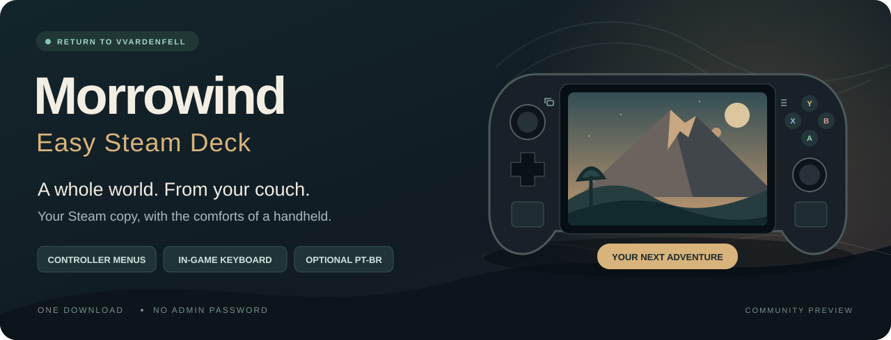

<p align="center"></p>

<p align="center">
  <a href="https://github.com/chadvictor/morrowind-easy-steamdeck/actions/workflows/ci.yml"></a>
  <a href="https://github.com/chadvictor/morrowind-easy-steamdeck/releases"></a>
  <a href="LICENSE"></a>
</p>

# Install Morrowind. Make it feel at home on your Deck.

**Turn your own Steam installation of Morrowind GOTY into a native OpenMW setup with controller menus, readable text and a familiar Play button.** Download one shell file, choose your settings, and let the installer do the rest.

**[Download the installer →](https://github.com/chadvictor/morrowind-easy-steamdeck/releases)** · [Controls](docs/controls.md) · [Settings](docs/settings.md) · [Help & undo](docs/troubleshooting.md)

> **Steam Deck preview:** the controller profile was successfully used on Windows with OpenMW 0.51.0. Installer logic is checked with automated fixtures; the complete SteamOS/Flatpak/Game Mode path has **not yet been tested on a physical Steam Deck**. We publish that distinction so you know exactly what to expect. [Validation details](docs/validation.md).

## What you get

| You choose | The installer handles |
| --- | --- |
| Your purchased Steam copy | Finds Morrowind on the internal drive or a mounted SD-card Steam library; asks for a folder if needed |
| Balanced, Battery or Quality | Sets up native OpenMW, modern lighting, distant terrain and practical graphics options |
| Controller mode | Applies the tested gameplay bindings and OpenMW's native controller-friendly menus |
| Comfortable text | Independent interface scale and text size options for a 1280 × 800 screen |
| Optional Brazilian Portuguese | Downloads and activates the PT-BR mod, interface language and character-creation/level-up text |
| Your existing Steam Play button | Connects app **22320**, with a backup and a restore action |

No administrator password. No Python, pip, Node, Git, dialog or package-manager commands for the player. The installer uses Bash and utilities already present on stock SteamOS, plus its preinstalled Flatpak. OpenMW and its runtime download from Flathub into your user account.

## Start here — no terminal commands required

1. **Install Morrowind GOTY through Steam.** Wait for the download to finish. If you installed it on an SD card, keep that card inserted. You do not need to launch the original game first.
2. **Switch to Desktop Mode.** On the Deck, use **Steam → Power → Switch to Desktop**.
3. **Download `install-morrowind.sh`.** Open the [Releases page](https://github.com/chadvictor/morrowind-easy-steamdeck/releases) and expand **Assets** on the newest preview. Choose the shell file, not GitHub's source-code ZIP.
4. **Make it executable.** In Dolphin, right-click the downloaded file → **Properties → Permissions → Is executable** (wording can vary). Open it and choose **Execute / Run in Konsole** if prompted. The file opens a terminal menu automatically when launched without one. If Dolphin opens a text editor, use right-click → **Open With → Konsole**, or see the [one-command fallback](docs/troubleshooting.md#the-file-opens-as-text).
5. **Choose `1 — Set up`.** Confirm the detected game folder. The defaults enable the controller profile, 1.25× UI scale, 18-point text, and Balanced graphics. Want Brazilian Portuguese? Turn on **`9 — Brazilian Portuguese (PT-BR)`**. It requires the English GOTY files and a new game. Press **I** to install. The first Flatpak download can be several GB; let it finish.
6. **Connect Steam.** For automatic setup, choose **Steam → Exit Steam** in Desktop Mode, then select **Connect the Steam Play button** in this installer. Choose your Steam account and apply the displayed Launch Options. If you prefer, the menu can show the line to paste manually.
7. **Reopen Steam and set a gamepad layout.** Open Morrowind's controller settings, enable Steam Input and select the **Gamepad with Joystick Trackpad** template, or a gamepad template with the right trackpad assigned to mouse. The sticks must send joystick input, not WASD/mouse emulation. [Full control guide](docs/controls.md).
8. **Return to Game Mode and press Play on Morrowind.** OpenMW launches directly. Use **Steam + X** when character creation needs a name. Use the right trackpad for any settings screen that still needs a pointer.

The menu accepts number keys and Enter. During setup you can use a keyboard or the Deck's on-screen keyboard; gameplay uses your controller layout.

### The menu

```text
  MORROWIND
  EASY STEAM DECK
  0.2.0-preview.1  |  Native OpenMW · No sudo
  ------------------------------------------------------------

  1  Set up / change graphics, controller and language
  2  Connect the Steam Play button
  3  Show manual Steam Launch Options
  4  Restore previous Steam Launch Options
  5  Diagnostics
  Q  Quit
```

## Optional: play in Brazilian Portuguese

In the setup screen, press **9** to enable **Brazilian Portuguese (PT-BR)**, then **I** to install. It is **off by default** for a new setup. The installer downloads the ready-made [Morrowind PT-BR mod](https://github.com/chadvictor/morrowind-traducao-ptbr), verifies its checksum and the supported English masters, and activates the plugin, localization resources, menu language, subtitles and 63 translated engine messages automatically. No Python or manual configuration edits are needed.

This release integrates translation **0.1.0-beta.2** with **OpenMW 0.51.0**. Start a **new game**: existing English campaigns are not converted. PT-BR saves have their own folder, separate from your original saves. To turn it off, rerun setup, set option **9** to **false**, and apply. The original language settings return; both sets of saves remain. An existing setup remembers whether PT-BR was enabled.

The translation is a community beta with AI-assisted translation and automated review; it has not had a complete human review or campaign playthrough. Voices and videos are not translated. [Installation details, compatibility and undo](docs/translation.md).

## Your copy, your saves, your settings

The game files stay in their Steam library. OpenMW reads them there; this installer does not bundle Morrowind, expansions, translation assets or texture packs. When you enable PT-BR, it downloads the separate mod directly from its published release.

This installer's profiles and saves live under:

```text
~/.local/share/morrowind-easy-steamdeck/
├── manage.sh          Run the menu again
├── launch.sh          The native launcher used by Steam
├── active             Selects the current profile
├── profiles/          Current and earlier configurations
├── mods/              Verified optional translation packages
├── userdata/saves/    Original-language OpenMW saves
├── userdata-ptbr/saves/ Separate PT-BR saves (when enabled)
└── steam-backup/      Original Steam Launch Options and restore data
```

If you set `XDG_DATA_HOME`, that location replaces `~/.local/share`. Existing OpenMW profiles and original Morrowind saves are not imported automatically. **Steam Cloud is not configured for these OpenMW saves**; back them up separately.

Changing a preset creates a fresh settings and bindings profile. Earlier profiles remain available, and the selected language's save directory is reused. Use the in-game options for small changes you want to keep. Full controller remapping through this installer is planned for a later version.

## How the Steam button works

The installer sets a Launch Options line like:

```sh
bash "/home/deck/.local/share/morrowind-easy-steamdeck/launch.sh" %command%
```

The generated line uses **your actual home directory**. Steam supplies its original Windows/Proton command at `%command%`; our launcher ignores those arguments and starts native Linux OpenMW through Flatpak. You do not need to select a special Proton version or install OpenMW inside a Proton prefix. This mechanism still needs confirmation in Game Mode on a physical Deck.

Steam must be closed for automatic editing, because it may overwrite its settings while running. Only Morrowind's Launch Options in the selected account are changed. Restore refuses to overwrite a Launch Options value you changed later; all unrelated account/game settings remain intact.

## Compatibility

| Supported target for this preview | Notes |
| --- | --- |
| Steam Deck LCD / OLED running stock SteamOS | x86_64, Desktop Mode installation, native Steam client |
| Steam Morrowind GOTY, app 22320 | Morrowind, Tribunal and Bloodmoon masters/archives plus Morrowind.ini |
| Internal SSD or mounted SD-card Steam library | Discovery reads Steam's library and app manifests |
| OpenMW 0.51.x from Flathub stable | The current stable version was 0.51.0 when this preview was prepared |
| Optional PT-BR: OpenMW 0.51.0 + supported English GOTY masters | Hash-checked source files; new game required; separate saves |

Windows, Steam installed as a Flatpak, heavily modded installations, alternate storefronts, and future OpenMW controller formats are outside this preview's supported target. The installer checks the engine version before applying its profile. Other Linux desktops may have the needed tools, but are not the target tested by this project.

## Learn more

- [Controller reference and Steam Input setup](docs/controls.md)
- [Every preset and why it exists](docs/settings.md)
- [Optional Brazilian Portuguese translation](docs/translation.md)
- [Troubleshooting, updates, rollback and removal](docs/troubleshooting.md)
- [Architecture, source references and licensing](docs/architecture.md)
- [What was tested, and the physical Deck checklist](docs/validation.md)
- [Contributing and running checks](CONTRIBUTING.md)

## Credits

[OpenMW](https://openmw.org/) provides the engine and native controller menus. [Flathub](https://flathub.org/en/apps/org.openmw.OpenMW) distributes the Linux package. [DadsMmoLab](https://github.com/DadsMmoLab/dads-mmo-lab) inspired the approachable, player-first script workflow; no code was copied from that project. The graphics presets draw on OpenMW's documented settings and [Modding-OpenMW's distant terrain guidance](https://modding-openmw.com/mods/distant-land-and-objects/), with conservative choices for a handheld.

The optional [Morrowind PT-BR project](https://github.com/chadvictor/morrowind-traducao-ptbr) supplies the translation. Its license, third-party notices and source catalogs remain with the downloaded package.

Independent community project. Not affiliated with Bethesda, Valve, OpenMW or Flathub. Morrowind and Steam Deck belong to their respective owners. The original installer code and artwork are [MIT licensed](LICENSE).
