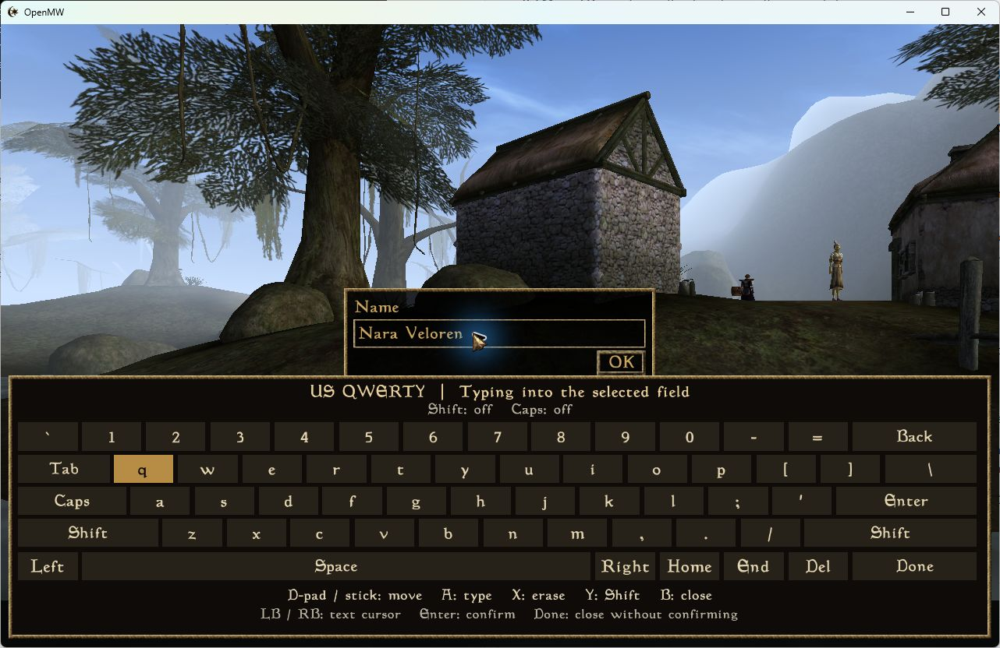
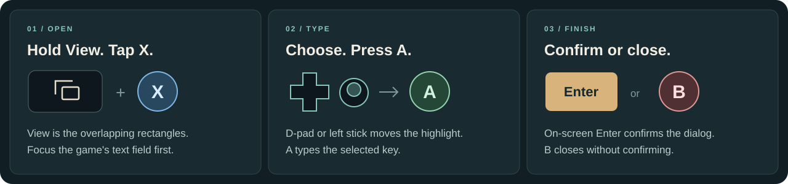

<p align="center">
  
</p>

<p align="center">
  <strong>Your Steam copy. A controller. All of Vvardenfell.</strong><br />
  Controller menus, an in-game keyboard, comfortable text and optional Brazilian Portuguese.
</p>

<p align="center">
  <a href="https://github.com/chadvictor/morrowind-easy-steamdeck/releases/download/v0.4.0-preview.1/install-morrowind.sh"><strong>Download the installer</strong></a>
  &nbsp; · &nbsp; <a href="#start-here--no-terminal-commands-required">Installation guide</a>
  &nbsp; · &nbsp; <a href="#a-keyboard-that-stays-in-the-game">See the keyboard</a>
  &nbsp; · &nbsp; <a href="https://github.com/chadvictor/morrowind-easy-steamdeck/releases">Release notes</a>
</p>

<p align="center">
  
  
  
</p>

**Morrowind Easy Steam Deck helps you turn a fresh Steam installation into a setup you can play from the couch.** It installs OpenMW, the modern engine that runs your existing Morrowind game files, and sets up the controls, menus and text size for a handheld.

Download one file, choose your options, then launch from **Morrowind's own Play button in Steam**. The installer finds your game on the internal drive or a mounted SD card. No administrator password or developer tools needed.

| Pick up and play | Type with your controller | Make yourself comfortable |
| --- | --- | --- |
| Familiar gameplay bindings and OpenMW's controller menus. Keep a trackpad handy for screens that need a pointer. | A US QWERTY keyboard inside the game, plus a shortcut that suggests a character name. | Adjustable interface and text sizes, three graphics presets and optional PT-BR. |

## A keyboard that stays in the game

Naming your character should be part of the adventure. **Hold View and tap X** to bring up a keyboard drawn by OpenMW itself. It stays over the current screen and types into the game's selected text field, independently of Steam's overlay.



<sub>Actual OpenMW 0.51 UI, captured in a Windows development preview at 1280 × 800. The name was entered for the demonstration. The new keyboard still needs a physical Steam Deck retest; this is not a Deck gameplay capture.</sub>



**View** is the small button with two overlapping rectangles. Release other buttons before using the shortcut. Once the keyboard is open:

| Want to… | Use… |
| --- | --- |
| Choose a key and type it | **D-pad / left stick**, then **A** |
| Delete the previous character | **X** |
| Make the next character uppercase or type a symbol | **Y** for Shift |
| Move the cursor within your text | **LB / RB** |
| Confirm the game's dialog | The keyboard's **Enter** key |
| Close the keyboard and keep editing later | **B**, **Menu** or the on-screen **Done** key |

There are **60 keys**, including numbers, punctuation, Caps Lock, Space and editing keys. You can open the panel on any screen; typing requires a focused text field. Use the trackpad to select one when needed. This first version uses US characters and gamepad navigation; accented characters and touch/mouse key selection are not included.

**Just want a name and to get going?** With the keyboard closed, **View + Y** suggests a fantasy name. Repeat to reroll, then press **A** to accept. OpenMW's controller save dialog already suggests a save description, too.

[Full controls and keyboard guide →](docs/controls.md)

## Start here — no terminal commands required

You need a **Steam Deck running SteamOS** and your own **Steam copy of Morrowind GOTY**, fully installed with its expansions. Keep Steam open during setup so its on-screen keyboard remains available.

### 1. Download on your Deck

Switch to **Desktop Mode** from **Steam → Power**, then [download `install-morrowind.sh`](https://github.com/chadvictor/morrowind-easy-steamdeck/releases/download/v0.4.0-preview.1/install-morrowind.sh).

Prefer to browse releases? Expand **Assets** on the [newest preview](https://github.com/chadvictor/morrowind-easy-steamdeck/releases) and choose `install-morrowind.sh`.

### 2. Open the installer

In Dolphin, right-click the file → **Properties → Permissions → Is executable**. Open it and choose **Execute / Run in Konsole** if prompted. Wording may vary.

If it opens as text, [follow this short fix](docs/troubleshooting.md#the-file-opens-as-text).

### 3. Choose your setup

Select **1 — Set up** and confirm the detected game folder. If it isn't found, paste its full folder path from Dolphin. Internal storage and mounted SD-card libraries are supported.

The defaults give you **Controller + UI**, **Balanced graphics**, **1.25× interface scale** and **18-point text**. Want Portuguese? Enable **9 — Brazilian Portuguese (PT-BR)** before applying.

Press **I** to install. The first engine download can be several GB, so give it time to finish.

### 4. Connect the Steam Play button

With Steam **still open**, choose **Connect the Steam Play button**. Select your account, review the change and choose whether to reopen Steam afterward.

**Exit Steam only when the installer tells you to.** It will detect the exit, apply the change and reopen Steam by default. You won't need to type or press Enter after closing Steam.

Prefer to do this yourself? The installer also offers **Show manual Steam Launch Options**.

### 5. Set your controller layout

In Morrowind's Steam controller settings, enable Steam Input and choose **Gamepad with Joystick Trackpad**, if available. A gamepad template with the right trackpad set to mouse also works.

Keep the sticks mapped as gamepad joysticks. [Controller setup details →](docs/controls.md#one-steam-input-step)

### 6. Return to Game Mode and play

Press **Play on Morrowind**. At the name field, try **View + X** for the keyboard or **View + Y** for a suggested name.

This is a **preview release**. A player has confirmed OpenMW, controller support and Portuguese text on a real Deck. The new keyboard and shortcuts still need a Deck retest, and complete Game Mode/overlay coverage is pending. [What has been tested →](docs/validation.md)

> **Already playing?** Close OpenMW, run the new installer and apply **1 — Set up** with **Controller + UI** enabled. Reconnecting Steam alone doesn't update the keyboard. Keep PT-BR enabled for your Portuguese campaign; your save directories are retained.

## Make it yours

**Read comfortably.** Adjust interface scale and font size separately. Start at the defaults, or try **1.5×** for larger menus. If a window gets cut off, step back to **1.25×**.

**Choose your graphics.** Balanced is the starting point; Battery and Quality offer different settings. These are presets to try, not measured battery-life or frame-rate promises. [Compare the settings →](docs/settings.md)

**Play in Brazilian Portuguese.** Enable option **9** during setup and the installer downloads and activates the [Morrowind PT-BR translation](https://github.com/chadvictor/morrowind-traducao-ptbr). It requires the supported **English Steam GOTY files** and a **new game**. Portuguese campaigns use their own save folder, so you can switch back to your original-language campaigns later.

The translation is a community beta with AI-assisted translation and automated review; a full human review is still pending. Voices and videos remain in their original language. [Translation details →](docs/translation.md)

## Your game. Your progress.

Your original game files stay in their Steam library. Setup keeps earlier profiles, and the automatic Steam connection has a **Restore previous Steam Launch Options** action.

**Back up your OpenMW saves separately: this setup does not configure Steam Cloud for them.** Existing original-game saves and other OpenMW profiles are not imported automatically.

For small changes you want to keep, use the in-game options. Running setup again applies a fresh settings profile while retaining the selected language's save directory.

## Need a hand?

| What happened? | Where to go |
| --- | --- |
| The installer opens as text, or the game won't launch | [Help and troubleshooting](docs/troubleshooting.md) |
| Buttons act like a mouse, or the keyboard won't appear | [Controller guide](docs/controls.md) |
| You want to update, undo the Steam connection or remove the setup | [Updates and undo](docs/troubleshooting.md#update-this-project-or-change-settings) |
| Something still isn't working | [Report a problem](https://github.com/chadvictor/morrowind-easy-steamdeck/issues), including your Deck model, SteamOS version and installer version |

**Stuck in a dialog?** Hold **View + Menu** for **3 seconds** to exit OpenMW. Menu is the button with three horizontal lines. This does **not** save progress; use the normal pause menu when available.

---

## Technical details

The player guide ends here. These notes cover compatibility, files, implementation and development.

<details>
<summary><strong>Supported versions and current limits</strong></summary>

| Component | Preview target |
| --- | --- |
| Device | Steam Deck LCD / OLED running stock SteamOS, x86_64 |
| Steam | Native Steam client; Desktop Mode installation |
| Game | Steam Morrowind GOTY, app 22320, with Tribunal and Bloodmoon |
| Storage | Internal SSD or mounted SD-card Steam library |
| Engine | OpenMW 0.51.x from stable Flathub |
| Optional PT-BR | Translation 0.1.0-beta.2; OpenMW 0.51.0 exactly; hash-checked English GOTY masters |

Windows installation, Flatpak Steam, alternate storefronts and heavily modded games are outside this preview's supported target. The installer checks engine compatibility before applying a profile. Screenshots from Windows document the UI's development, not Windows installer support.

Full controller remapping and a custom inventory redesign are future work. Morrowind retains its own game mechanics.

</details>

<details>
<summary><strong>How installation and Steam integration work</strong></summary>

The installer uses Bash and utilities already available on stock SteamOS. It installs OpenMW and its runtime from Flathub for the current user. The player doesn't need Python, Node, Git, a compiler or an administrator password.

The Steam connection writes a line like this to Morrowind's Launch Options:

```sh
bash "/home/deck/.local/share/morrowind-easy-steamdeck/launch.sh" %command%
```

The generated line uses the actual home directory. Steam's original Windows/Proton arguments are ignored; the launcher starts native Linux OpenMW through Flatpak.

Automatic edits affect only app 22320's Launch Options in the selected account. A backup, concurrency checks and guarded restore protect the existing value. All questions come before Steam exits; the installer waits up to three minutes and then finishes without another keypress.

The controller helper uses public SDL2 functions. The keyboard is an original OpenMW Lua MENU script that preserves the native text field's focus. Helper and UI files are bundled in the installer and checksum-verified when installed/launched. Game executables remain unchanged.

[Architecture and source references →](docs/architecture.md)

</details>

<details>
<summary><strong>Where profiles and saves live</strong></summary>

```text
~/.local/share/morrowind-easy-steamdeck/
├── manage.sh             Reopen the installer menu
├── launch.sh             Launch from Steam
├── active                Selected profile
├── profiles/             Current and earlier settings
├── mods/                 Optional translation packages
├── userdata/saves/       Original-language campaigns
├── userdata-ptbr/saves/   Portuguese campaigns
└── steam-backup/         Launch Options backup and restore data
```

`XDG_DATA_HOME`, when set, replaces `~/.local/share`. Keep both save directories when backing up or removing the setup.

[Rollback and removal →](docs/troubleshooting.md)

</details>

<details>
<summary><strong>Testing and contributing</strong></summary>

Automated checks run on Ubuntu 22.04 and 24.04: real SDL2 events and virtual-controller polling, Lua UI lifecycle/layout, Steam discovery and reversible edits, profile/save isolation, PT-BR package verification and generated-installer extraction.

The actual OpenMW 0.51.0 engine on Windows was used to inspect the keyboard at 1280 × 800 with UI scales 1.25 and 1.5, and to check text-focus preservation. These checks don't replace physical Deck acceptance.

[Validation and hardware checklist](docs/validation.md) · [Contributing and build instructions](CONTRIBUTING.md) · [Changelog](CHANGELOG.md)

[](https://github.com/chadvictor/morrowind-easy-steamdeck/actions/workflows/ci.yml)

</details>

## Credits and license

[OpenMW](https://openmw.org/) provides the engine and native controller menus; [Flathub](https://flathub.org/en/apps/org.openmw.OpenMW) distributes it. [Morrowind PT-BR](https://github.com/chadvictor/morrowind-traducao-ptbr) supplies the optional translation. [DadsMmoLab](https://github.com/DadsMmoLab/dads-mmo-lab) inspired the approachable installer workflow; no code was copied. Presets draw on OpenMW's documentation and [Modding-OpenMW's distant terrain guidance](https://modding-openmw.com/mods/distant-land-and-objects/).

The original installer, helper, Lua UI and illustrations are [MIT licensed](LICENSE). The UI screenshot depicts Morrowind's copyrighted game artwork; those game assets are not covered by this project's MIT license. OpenMW and the downloaded translation retain their own licenses and notices.

Independent community project, not affiliated with Bethesda, Valve, OpenMW or Flathub. No game files are distributed.
